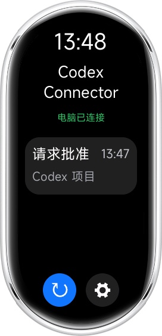
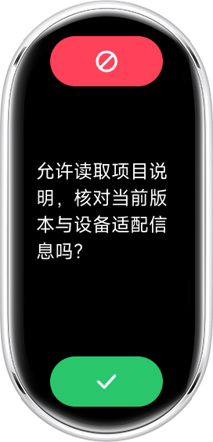
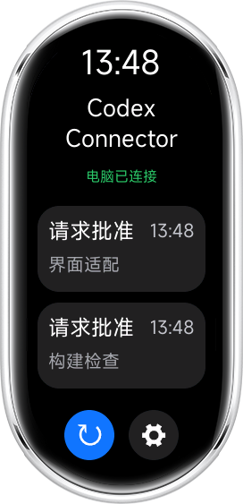
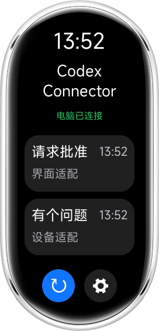
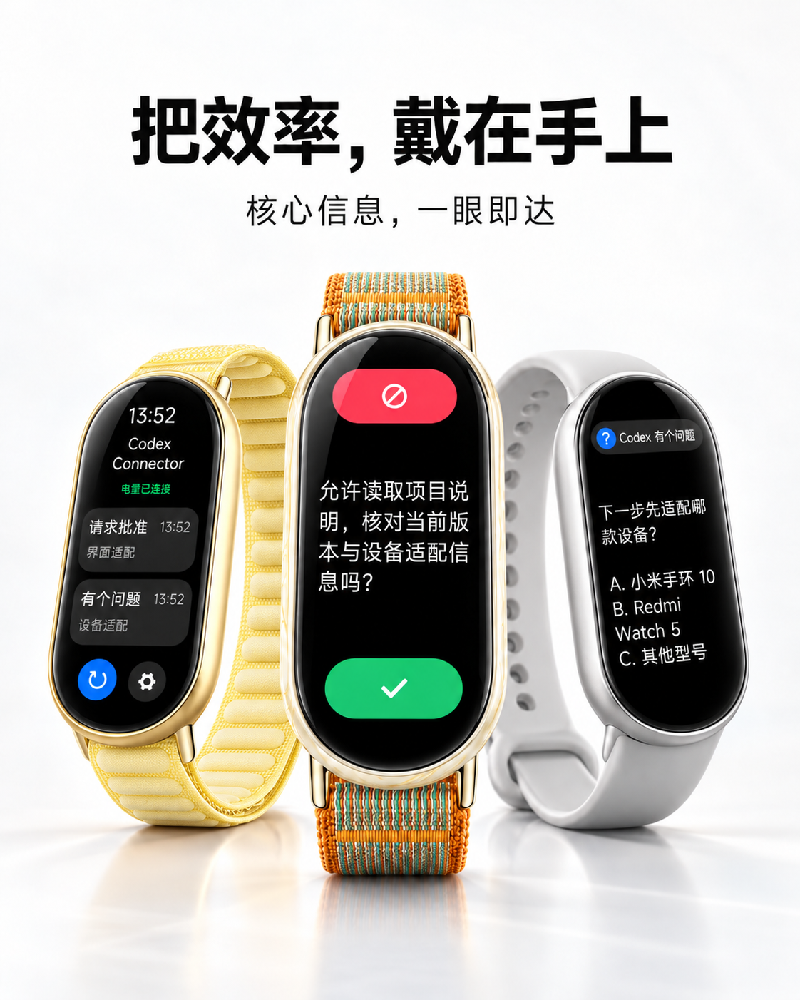
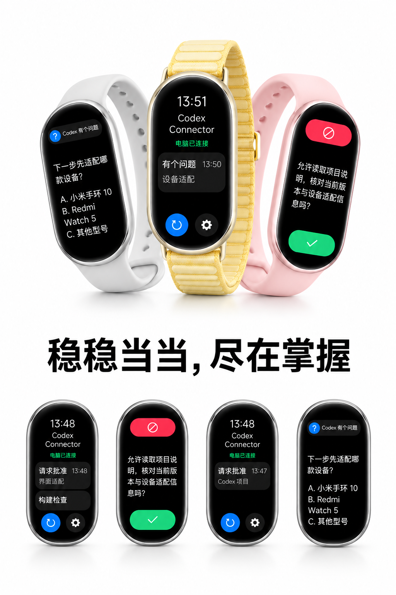

# Codex Band Connector

抬腕查看，轻点授权。配合 Codex Band Bridge，在小米手环 10、10 NFC、11 及 11 NFC 上查看授权请求、同步批准或拒绝，并显示多条请求队列；问题回答仍在电脑完成。

当前版本 **1.3.1 / 13001**，更新日期2026年10月21日。已更新标准 release 打包与资源页素材，等待平台重新审核。


## 下载与安装

[下载 1.3.1](https://github.com/DecafDoppio/Codex-Band-Connector/releases/tag/v1.3.1) · [全部 Releases](https://github.com/DecafDoppio/Codex-Band-Connector/releases)

## 适配情况
当前适配小米手环 10、10 NFC、11 及 11 NFC。

## 使用方法
下载 Release 中的 RPK，通过 AstroBox 安装到小米手环 10、10 NFC、11 及 11 NFC。真机已验证：手环 11（xmb11），固件 4.100.139；保持应用前台运行。问题在手环展示，回答在电脑完成。

配套项目：[Codex Band Bridge](https://github.com/DecafDoppio/Codex-Band-Bridge)。两侧均使用 1.3.1，不新增强制捆绑安装。

## 界面展示

以下为 AIoT 模拟器中实际运行的界面，包含模拟器设备外壳。授权与问题内容为截图测试样例，问题仍在电脑端回答。

<table>
  <tr><th>单条授权</th><th>授权详情</th><th>多条授权</th></tr>
  <tr>
    <td></td>
    <td></td>
    <td></td>
  </tr>
  <tr><th>有个问题</th><th>问题详情</th><th>授权与问题并列</th></tr>
  <tr>
    <td></td>
    <td></td>
    <td></td>
  </tr>
</table>

截图来自 1.3.1 独立测试副本，保留正式界面与业务逻辑，仅适配模拟器通信；不作为真机互联验收。素材来源见 [MEDIA_SOURCES.md](MEDIA_SOURCES.md)。

## 艺术化展示

以下两张为维护者提供的艺术化宣传图，界面与设备经过艺术化呈现；实际运行界面见上方六张模拟器截图。问题回答仍在电脑端完成。

<table>
  <tr><td></td><td></td></tr>
</table>

## 从源码构建

Node 24.19.0、aiot-toolkit 2.0.5（package-lock.json 锁定）：

```powershell
npm ci
npm run build
```

普通 build 生成调试包。官方发布包沿用现有签名身份，签名文件须置于仓库之外：

```powershell
$env:CODEX_BAND_SIGN_KEY = '外部正式私钥绝对路径'
$env:CODEX_BAND_SIGN_CERT = '外部正式证书绝对路径'
npm run release
```

输出 dist/com.local.codexband.release.1.3.1.rpk；dist、build、node_modules 均不提交。构建通过标准 `aiot release` 直接生成正式签名包，不读取历史 RPK，也不在编译后改写包体。src/manifest.json 与 release.json 的发布名称、版本 1.3.1/13001 保持一致；quickapp.config.js 使用官方签名回调读取外部证书与私钥，并校验既有签名身份。

这是可独立编译的还原 UX/JS 源码，不冒称找回原始手写源码。官方同身份签名需要维护者持有的私钥；普通用户可构建调试包。

## 发布、验证与反馈

main 保存源码及构建输入；安装包放 GitHub Releases，AstroBox 所需文件使用独立发布分支，见 [PUBLISHING.md](PUBLISHING.md)。本次审核修正的验证范围见 [REVIEW_FIX_2026-10-16.md](REVIEW_FIX_2026-10-16.md)。

检查结果及限制见 [VALIDATION.md](VALIDATION.md)。通过 [Issues](https://github.com/DecafDoppio/Codex-Band-Connector/issues) 反馈。自有代码采用 [MIT](LICENSE)，第三方许可证与通知保留，见 [THIRD_PARTY_NOTICES.md](THIRD_PARTY_NOTICES.md)。

社区项目，与 OpenAI、AstroBox 和小米官方无隶属关系。
